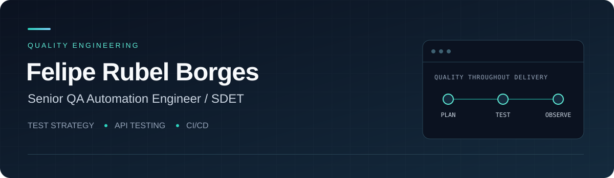

 

**Joinville, SC · Brasil · Experiência com equipes globais**

[Sobre](#sobre) &nbsp; · &nbsp; [Competências](#competencias) &nbsp; · &nbsp; [Projetos](#projetos) &nbsp; · &nbsp; [Experiência](#experiencia) &nbsp; · &nbsp; [Formação](#formacao)

## Qualidade do requisito à produção

Sou **Senior QA Automation Engineer / SDET**, com atuação em qualidade de software desde **2015**. Trabalho com estratégia de testes, automação web e mobile, testes de APIs e validação de integrações, combinando testes manuais e automatizados conforme o risco e o contexto do produto.

Atualmente, atuo na **Amaris Consulting**, em projetos para a **Renault**, com foco em APIs, microsserviços, fluxos de eventos e automação com Playwright. Minha trajetória também inclui projetos para **ExxonMobil**, **Thomson Reuters** e **TOTVS Labs**, em ambientes ágeis e equipes multiculturais.

Meu foco é construir automações sustentáveis, antecipar problemas e dar ao time evidências claras para decidir sobre a qualidade de cada entrega.

## Competências principais

| Frente | Tecnologias e atuação |
| :--- | :--- |
| **Automação de testes** | Playwright · Cypress · Selenium · Java · JavaScript · TypeScript |
| **APIs e integrações** | Postman · Bruno · testes de microsserviços · Kafka · fluxos orientados a eventos |
| **Estratégia e execução** | Testes funcionais, exploratórios, de regressão e entre dispositivos · análise de requisitos · Shift Left |
| **CI/CD e ambientes** | GitHub Actions · GitLab CI/CD · Azure DevOps · Jenkins · Docker |
| **Dados e observabilidade** | SQL · PostgreSQL · MongoDB · NoSQL · Datadog · Dynatrace |
| **Colaboração** | BDD/Cucumber · Jira · Xray · Azure Boards · Scrum · Kanban |

<strong>＋ Outras ferramentas e contextos de experiência</strong>

- **Performance e carga:** k6 e JMeter.
- **Mobile:** testes manuais e automação com TestProject, incluindo aplicações com reconhecimento facial.
- **Cloud:** Azure e Google Cloud.
- **IA no fluxo de QA:** GitHub Copilot para apoiar a criação de scripts e o desenho de casos de teste, com revisão técnica.
- **Comunicação internacional:** reuniões e colaboração profissional em inglês.

### Boas práticas que orientam meu trabalho

- **Prevenção desde o início:** análise de requisitos e impactos, abordagem Shift Left e cenários alinhados aos riscos do negócio.
- **Automação com manutenção em mente:** separação de responsabilidades, Page Objects quando adequados, comandos reutilizáveis e cenários legíveis com BDD.
- **Cobertura em diferentes camadas:** combinar testes de API, integração e interface, além de exploração manual e validação de casos extremos.
- **Feedback contínuo:** executar testes em pipelines e disponibilizar relatórios para facilitar a análise das falhas.
- **Dados e ambientes controlados:** usar dados de teste apropriados, limpar recursos criados e manter credenciais fora do código.
- **Diagnóstico com evidências:** investigar logs, requisições, eventos e dados para entender falhas e validar comportamentos.

## Projetos em destaque

Uma seleção de projetos públicos de estudo e avaliação técnica. Cada um permite explorar uma parte da minha prática em automação.

### 01 · Automação web com Cypress e BDD

**Cypress · JavaScript · Cucumber · Page Objects · GitHub Actions**

Projeto de avaliação técnica NinjaOne com cenários de autenticação, criação de conta, recuperação de senha e solicitação de ativação. Inclui pipeline para execução dos testes e publicação de relatório HTML como artefato.

[Explorar projeto →](https://github.com/FelipeRubelBorges/NinjaOne) &nbsp; · &nbsp; [Ver cenários BDD](https://github.com/FelipeRubelBorges/NinjaOne/tree/main/cypress/e2e/features) &nbsp; · &nbsp; [Ver pipeline](https://github.com/FelipeRubelBorges/NinjaOne/blob/main/.github/workflows/main.yml)

Ver práticas demonstradas

- Page Objects para organizar interações e responsabilidades das páginas.
- Cenários Gherkin para descrever os comportamentos testados.
- Geração de dados com Faker e configuração de viewports.
- Execução pelo GitHub Actions com credenciais fornecidas por secrets.
- Relatórios HTML disponíveis como artefatos da execução.

### 02 · Testes em camadas para GitLab

**Cypress · JavaScript · API · GUI · CLI**

Projeto com cenários de criação de projetos e issues, login e organização de issues. Explora o uso conjunto de testes de API, interface e linha de comando.

[Explorar projeto →](https://github.com/FelipeRubelBorges/Cypress-gitlab) &nbsp; · &nbsp; [Ver testes por camada](https://github.com/FelipeRubelBorges/Cypress-gitlab/tree/main/cypress/e2e) &nbsp; · &nbsp; [Ver comandos de API](https://github.com/FelipeRubelBorges/Cypress-gitlab/blob/main/cypress/support/api_commands.js)

Ver práticas demonstradas

- Organização dos testes em API, GUI e CLI.
- Comandos reutilizáveis para preparar dados e interagir com a API.
- Token de acesso fornecido por variável de ambiente, sem registro nos logs das requisições.
- Rastreamento e remoção dos projetos criados durante os testes.

### 03 · Automação com Playwright

**Playwright · JavaScript · Node.js · Faker · PostgreSQL**

Projeto de testes do sistema Zombie Plus, desenvolvido durante o curso Playwright Zombie Edition. Reúne execução de testes em modo headless e consulta aos relatórios do Playwright.

[Explorar projeto →](https://github.com/FelipeRubelBorges/playwright) &nbsp; · &nbsp; [Ver documentação e execução](https://github.com/FelipeRubelBorges/playwright#readme)

Ver tecnologias e execução

- Playwright com JavaScript e Node.js.
- Faker e PostgreSQL no contexto do projeto.
- Execução com `npx playwright test`.
- Consulta ao relatório com `npx playwright show-report`.

[Ver todos os repositórios públicos →](https://github.com/FelipeRubelBorges?tab=repositories&type=public)

## Experiência profissional

**Amaris Consulting · Senior Software Quality Assurance Engineer**  
Jun. 2025 – atual · Consultoria para Renault

Testes manuais e automatizados de APIs, aplicações web/mobile e integrações. Automação com Playwright, validação de microsserviços e fluxos de eventos, análise com Dynatrace e apoio à validação de pipelines GitLab CI/CD. Trabalho com SQL/NoSQL, Jira/Xray e equipes internacionais.

<strong>Expandir trajetória anterior · 2015–2025</strong>

### Pantheon Inc · Senior Software Quality Assurance Engineer

**Mai. 2022 – mai. 2025 · Consultoria para ExxonMobil**

Testes de APIs e regressão com Postman e Datadog, validação de microsserviços Spring Boot e integrações via Kafka. Atuação com Azure DevOps, GitHub Actions, MongoDB e PostgreSQL em equipe global.

### Vetor IT · Software Quality Assurance Analyst

**Fev. 2021 – jan. 2022 · Consultoria para Thomson Reuters**

Jobs e pipelines com Jenkins, consultas e manipulação de dados com SQL, containers Docker e análise de logs com Datadog. Testes funcionais e manuais e validação de requisitos.

### TOTVS Labs · Software Quality Assurance Analyst

**Jan. 2020 – jan. 2021**

Qualidade de aplicações com reconhecimento facial, incluindo testes funcionais, testes mobile e automação com TestProject. Colaboração com Product Owner e desenvolvimento na definição do backlog e treinamento de consultores e suporte.

### Thomson Reuters Brazil · Software Quality Assurance Analyst

**Jan. 2015 – jan. 2020**

Testes de soluções fiscais e contábeis MasterSAFDW e TAXONE em desktop e web. Automação com Selenium, BDD/Cucumber, testes de carga com JMeter e uso de SQL, Jenkins e Docker.

## Formação e certificações

| Formação | Instituição | Período |
| :--- | :--- | :--- |
| **MBA em Liderança, Gestão de Equipes e Produtividade** | PUCRS | 2024–2025 |
| **Bacharelado em Sistemas de Informação** | Católica de Santa Catarina | 2014–2018 |

**BSTQB · Certified Tester, Foundation Level (CTFL)**  
**BSTQB · Certified Tester, Agile Tester (CTFL-AT)**

**Idiomas:** português nativo · inglês nativo/bilíngue · espanhol profissional.

<strong>EN · Professional summary in English</strong>

### Felipe Rubel Borges · Senior QA Automation Engineer / SDET

Based in Joinville, Brazil, I have worked in software quality since 2015, combining test strategy, manual and automated testing, API validation and CI/CD. I collaborate with global teams and conduct professional meetings in English.

I currently work at **Amaris Consulting**, providing QA and test automation consulting for **Renault**. My previous experience includes consulting for **ExxonMobil** through Pantheon Inc, **Thomson Reuters** through Vetor IT, and roles at **TOTVS Labs** and **Thomson Reuters Brazil**.

My core tools include **Playwright, Cypress, Selenium, Java, JavaScript, TypeScript, Postman and Bruno**. My experience also covers microservices, Kafka integrations, SQL/NoSQL, Docker, CI/CD, Datadog and Dynatrace.

I focus on maintainable automation, early feedback, risk-informed test coverage and evidence-based investigation. I hold **CTFL and CTFL-AT certifications**, a bachelor's degree in Information Systems and an MBA in Leadership, Team Management and Productivity.

[Connect on LinkedIn](https://www.linkedin.com/in/feliperubelborges/) · [Email me](mailto:felipe.rubel@hotmail.com)

---

**Vamos conversar sobre qualidade de software?**  
[LinkedIn](https://www.linkedin.com/in/feliperubelborges/) &nbsp; · &nbsp; [E-mail](mailto:felipe.rubel@hotmail.com) &nbsp; · &nbsp; [Voltar ao início ↑](#sobre)

